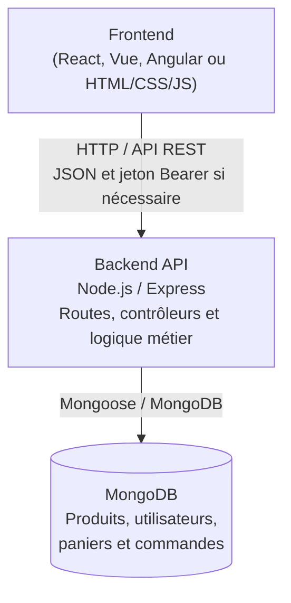

# Backend e-commerce motos

## Démarrage

1. Démarrez MongoDB.
2. Dans `backend/.env`, renseignez `MONGODB_URI` et définissez `JWT_SECRET` avec une valeur aléatoire d'au moins 32 caractères.
3. Depuis la racine du projet, lancez `npm run dev` ou `npm start`.

L'API écoute sur `http://localhost:3200/api` par défaut. Si le frontend tourne sur un autre port, configurez son proxy de développement vers `http://localhost:3200`, ou remplacez les URLs relatives `/api/...` par l'URL complète du backend.

## Vitrine incluse

La page fournie est disponible dans `backend/public` et est servie par Express : démarrez MongoDB puis `npm start`, et ouvrez `http://localhost:3200`. Elle charge le catalogue depuis MongoDB et fournit les formulaires de connexion/inscription, le panier et la création de commande via l'API.

## Architecture



Le frontend appelle les routes REST exposées sous `/api`. Le backend valide et traite les requêtes, puis lit ou enregistre les données dans MongoDB. Cette application utilise MongoDB (base NoSQL) ; PostgreSQL/SQL n'est pas configuré.

## Seed des produits initiaux

Avec MongoDB démarré et `MONGODB_URI` configuré dans `backend/.env`, lancez depuis la racine `npm run seed`. Le script ajoute les produits Neo et TVS Sport 100 avec un stock initial de 10 chacun. Il peut être relancé sans dupliquer ni écraser les produits existants.

## Exemple frontend

```javascript
const API_URL = '/api';

// Récupérer les motos triées par prix décroissant.
const response = await fetch(`${API_URL}/products?category=moto&sort=price-high`);
if (!response.ok) throw new Error('Impossible de récupérer les produits');
const products = await response.json();

// À récupérer après l'inscription ou la connexion.
const token = loginResult.token;

const addToCart = async (productId, quantity) => {
  const response = await fetch(`${API_URL}/cart/add`, {
    method: 'POST',
    headers: {
      'Content-Type': 'application/json',
      Authorization: 'Bearer ' + token,
    },
    body: JSON.stringify({ productId, quantity }),
  });
  const data = await response.json();
  if (!response.ok) throw new Error(data.message || 'Impossible d’ajouter au panier');
  return data;
};

const checkout = async (cartItems, shippingAddress) => {
  const response = await fetch(`${API_URL}/orders`, {
    method: 'POST',
    headers: {
      'Content-Type': 'application/json',
      Authorization: 'Bearer ' + token,
    },
    body: JSON.stringify({ items: cartItems, shippingAddress }),
  });
  const data = await response.json();
  if (!response.ok) throw new Error(data.message || 'Impossible de créer la commande');
  return data.order;
};
```

`cartItems` doit contenir des identifiants produit et quantités, par exemple `[{ productId: 'ID_MONGODB_DU_PRODUIT', quantity: 1 }]`. Le frontend ne transmet pas les prix : le backend les relit dans MongoDB, vérifie le stock et calcule le total. `shippingAddress` est facultatif dans l'API ; lorsqu'il est fourni, il doit contenir `name`, `phone`, `street`, `city`, `postalCode` et `country`.

Les appels panier, commande et profil demandent le jeton JWT renvoyé par `POST /api/users/login` ou `POST /api/users/register`, dans l'en-tête `Authorization`. Pour les routes disponibles et l'administration, consultez la liste ci-dessous.

## Routes principales

- `GET /api/health` : vérification du serveur.
- `GET /api/products`, `GET /api/products/:id` : catalogue ; filtres facultatifs `category`, `search` (ou `q`) et `sort` (`price-low` ou `price-high`).
- `POST /api/users/register`, `POST /api/users/login`, `GET /api/users/me` : création de compte, connexion et profil.
- `GET /api/cart`, `POST /api/cart/add`, `POST /api/cart/items`, `PATCH /api/cart/items/:productId`, `DELETE /api/cart/items/:productId` : panier.
- `POST /api/orders`, `GET /api/orders`, `GET /api/orders/:id` : commandes.
- `POST /api/products`, `PATCH /api/products/:id`, `DELETE /api/products/:id`, `PATCH /api/orders/:id/status` : administration.

Les routes d'administration exigent un compte de rôle `admin`. Après avoir créé un compte, attribuez ce rôle depuis la console MongoDB, par exemple :

```javascript
db.users.updateOne({ email: "admin@example.com" }, { $set: { role: "admin" } })
```

Ne publiez pas `backend/.env`.
